# ClauseTower — 계약을 읽는 물류 관제탑

**마감 임박 순이 아니라, 배상 노출 순으로.**

물류 교란(태풍, 항만 적체, 자사 시스템 장애)이 터지면 관제실은 마감이 임박한 화물부터 보낸다. 그런데 배상이 발생하는 순서는 마감 순서가 아니다. ClauseTower는 고객별 계약서의 지체상금·SLA 조항을 LLM이 읽고, 결정적 코드가 "한 사이클 더 보류하면 어느 계약에서 얼마의 배상이 발생하는가"를 계산하고, 그 순서로 배차하며, 사건 직후 해야 할 조치(우선 배차 대상, 불가항력 통지, 성립시킬 면책)를 계약서 조항 번호와 함께 띄운다.

사내 해커톤 출품작이다. 고객·계약·사건은 전부 가상이고, 문서의 숫자는 모두 이 저장소의 코드가 낸 측정값이다.

| 한눈에 | |
| --- | --- |
| 라이브 데모 | **https://namojo.github.io/clausetower/** — 서버 없이 브라우저 안에서 시뮬레이션이 돌고, 계약서를 올리면 AI가 바로 읽는다 |
| 문제 | 교란 때 마감 임박 순으로 배차하면, 면책·통지 시한·유예·상한·사유 불문 조항 때문에 정작 배상이 발생하는 화물이 뒤로 밀리고 받을 수 있던 면책을 놓친다 |
| 해법 | LLM이 계약을 읽고 면책을 판단 → 결정적 코드가 노출액을 계산 → 시뮬레이터가 정책을 비교해 증명 → 조치 보드가 지금 할 일을 띄운다 |
| 결과(측정) | 같은 화물·같은 교란에서 순서만 바꿔 총 배상금 **58~77% 절감**(시나리오 3종), 시드 30개 × 3종에서 **90/90 승** |
| 실제 모델(측정, 2회 실행) | Claude가 계약서 8부를 읽은 추출 정확도 **95.3~96.2%**(106항목), 면책 판단 태풍 **100%** · 항만 적체 **93.8~96.9%**, 인용 원문 일치 **100%**, 1회 실행당 호출 24회 약 $2 |
| 근거 | 모든 판단에 계약서 **조항 번호와 원문 인용**이 붙고, 한 번의 클릭으로 그 문장이 열린다 |
| 돌려 보기 | `pip install -e .` 뒤 `python -m clausetower demo --llm mock` → `out/demo/dashboard.html` (네트워크 불필요, 10초) |

**차례**

1. [왜 만들었나](#1-왜-만들었나)
2. [핵심 아이디어: 배상 노출액](#2-핵심-아이디어-배상-노출액)
3. [서비스 화면](#3-서비스-화면)
4. [데모 데이터: 계약 8부와 사건 3종](#4-데모-데이터-계약-8부와-사건-3종)
5. [어떻게 동작하나](#5-어떻게-동작하나)
6. [측정 결과](#6-측정-결과)
7. [선행 조사](#7-선행-조사-이미-있는-것과-없는-것)
8. [빠른 시작과 검증 절차](#8-빠른-시작과-검증-절차)
9. [저장소 구조와 설계 원칙](#9-저장소-구조와-설계-원칙)
10. [한계와 다음](#10-한계와-다음)
11. [심사 기준에 대한 답과 문서](#11-심사-기준에-대한-답과-문서)

---

## 1. 왜 만들었나

### 1-1. 현장의 문제

태풍이 상륙한 아침, 트럭 8대 중 4대가 결항하고 남부 노선은 1.6배 느려졌다. 관제실에는 대기 화물이 45건 쌓여 있다. 운영자는 늘 하던 대로 **마감 임박 순**으로 트럭을 배정한다. 합리적으로 보이지만, 세 가지가 어긋난다.

- **같은 지연, 다른 배상금.** 어떤 계약은 24시간 유예가 있어 하루 늦어도 0원이고, 어떤 계약은 지연 1건당 50만 원의 위약금이 즉시 발생한다. 시간당 요율에 상한이 없는 계약은 매 시간 배상금이 누적된다. 마감이 임박한 화물이 곧 배상이 발생하는 화물은 아니다.
- **면책은 조건부다.** 태풍이 면책 사유에 있어도 "12시간 이내 서면 통지"를 놓치면 못 쓴다. "대체 운송수단 확보 노력을 입증"하라는 조건이 붙은 계약도 있다. 사고 중에 이 시한을 아는 사람이 없어 받을 수 있던 면책을 날린다.
- **조항은 PDF 속에 있다.** 고객 8곳의 계약서 수십 쪽을 사고 중에 펴 놓고 계산하는 사람은 없다. 결과는 사후 정산 때 법무와 영업이 "그 조항이 있었네"를 알게 되는 것으로 끝난다.

### 1-2. 기획의 출발점

계약 분석 도구(CLM)는 조항을 "찾아 주고", 배차 최적화 도구는 마감과 거리로 "순서를 정한다". 둘 사이에 빈 자리가 있다. **계약 조항을 사건별 실제 노출액으로 바꾸고, 그 값으로 운영 순서를 바꾸며, 그 돈의 근거를 조항 원문으로 보여 주는 것.** 한국어 지체상금 맥락(역일·영업일, 누진, 정액, 통지 시한, 입증 조건)을 다루는 도구는 찾지 못했다(7절).

### 1-3. 누가 쓰나

| 사용자 | 언제 | 무엇을 얻나 |
| --- | --- | --- |
| 관제·배차 운영자 | 교란 발생 직후 몇 시간 | 우선 배차 대상, 불가항력 통지 현황, 입증 자료만 챙기면 성립하는 면책을 금액과 함께 |
| 계약·영업 담당자 | 사후 정산, 계약 갱신 | 어느 조항이 얼마를 물렸는지 항목별 근거. 상한·유예가 없는 계약이 어디인지 |
| 확장 영역 | 제조 납기 지체상금, IT 운영 SLA 크레딧, 건설 공정 지체상금 | "계약 조항 × 운영 사건 → 돈"인 모든 B2B 운영 |

---

## 2. 핵심 아이디어: 배상 노출액

교란 때 필요한 질문은 "어느 화물이 급한가"가 아니라 **"한 사이클 더 보류하면 어느 계약에서 얼마의 배상이 추가로 발생하는가"**다. 이 값을 **배상 노출액**(한계 배상액)이라 부른다. ClauseTower는 세 단계로 이 값을 만들고 네 번째 단계에서 증명하며, 다섯 번째 단계에서 조치로 바꾼다.

| 단계 | 누가 | 하는 일 |
| --- | --- | --- |
| ① 계약 읽기 | LLM | 계약서 전문에서 과금 방식(시간당·일당·영업일·누진·건당 정액), 요율, 유예, 상한과 범위, 불가항력 사유, 통지 시한, 정성 조건을 구조화한다. 모든 항목에 **조항 번호와 원문 인용**이 붙고, 인용이 원문에 글자 그대로 있는지 코드가 검증한다 |
| ② 면책 판단 | LLM | 이번 사건이 각 계약의 면책 사유에 해당하는지, 통지 시한과 정성 조건을 충족했는지 판단한다. 최종 적용 여부는 모델의 답을 믿지 않고 `조항 있음 ∧ 사유 해당 ∧ 통지 충족 ∧ 조건 충족`으로 **기계적으로 결합**한다 |
| ③ 노출액 계산 | 결정적 코드 | 지연 시간을 넣으면 유예 → 단위 올림 → 요율·누진·정액 → 건별 상한 → 고객 합계 상한 순서로 금액과 **계산 단계 문장**을 낸다. LLM은 여기 들어오지 않는다 |
| ④ 배차와 증명 | 시뮬레이터 | 트럭이 빌 때마다 '배상 노출액'이 큰 화물부터 보낸다. 같은 화물·같은 교란에서 기존 정책 4개와 총 배상금을 비교하고 지역 탐색 상한선까지 둔다 |
| ⑤ 조치 | 코드 + 인용 | 우선 배차 대상 3건, 통지 시한이 걸린 계약과 놓쳤을 때 배상 노출액, 조건 하나로 성립하는 면책과 그 금액을 조항 번호와 함께 띄운다 |

**돈 계산을 LLM에 맡기지 않는 것이 설계의 핵심이다.** LLM은 읽고 판단하고, 코드가 계산하고, 시뮬레이터가 심판한다. 그래서 틀렸을 때 어디가 틀렸는지 항목 단위로 추적되고, 사람이 어느 판단이든 뒤집을 수 있다.

---

## 3. 서비스 화면

시나리오 "태풍 상륙"을 기준으로 위에서 아래로 내려가며 설명한다. 화면 순서는 **조치가 먼저, 설명은 그 다음**이다. 운영자가 사건 직후 첫 화면에서 해야 할 일을 끝내고, 아래로 내려가며 근거를 확인한다.

### 3-1. 관제 요약과 지금 조치

맨 위에 두 숫자가 있다. 기존(마감 임박 순) 12,834,000원 대 ClauseTower 2,996,500원, 절감 76.7%. 우선순위 지역 탐색이 찾은 근사 최적은 2,921,000원이라 단순 규칙이 상한선의 97%에 닿는다.

숫자 바로 아래가 **조치 보드**다. ① 우선 배차 대상 3건(한 사이클 보류 시 추가 배상액이 큰 순), ② 면책 사유에는 해당하는데 통지 시한이 걸린 계약과 놓쳤을 때의 금액, ③ 입증 자료 같은 정성 조건 하나로 성립하는 면책과 그 금액. 하단에 "통지·요건 충족으로 회피 가능한 배상금"과 "배차로만 절감"의 합계가 붙는다. 모든 항목에 "조항 보기"가 있다.

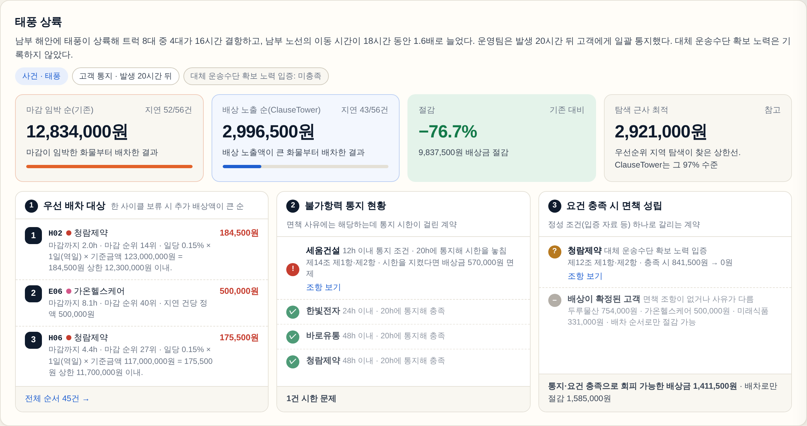

웹 데모에서는 조치 보드의 **"통지 12h로 시뮬레이션"**, **"충족으로 바꿔 보기"** 버튼이 왼쪽 패널 값을 바꿔 전체를 그 가정으로 다시 계산한다. "그랬다면 얼마가 달라졌나"를 숫자로 바로 본다.

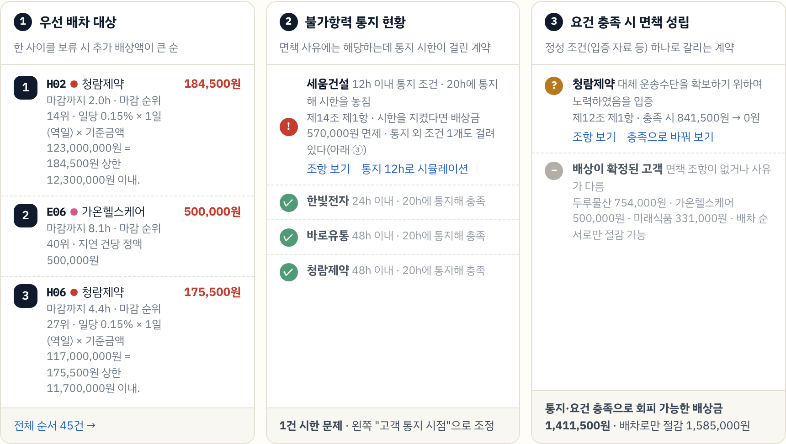

### 3-2. 배상 노출 순위

대기열이 가장 길었던 +15.9시간 시점, 대기 45건의 두 순위를 나란히 둔다. 왼쪽이 ClauseTower 순위, 그 옆이 기존 마감 순위와 변동이다.

- 마감 1위였던 세움건설 C05는 배상 노출 **14위**로 밀린다. 통지 시한을 놓쳐 면책은 못 받지만, 한 사이클 보류해도 배상금이 안 늘기 때문이다.
- 마감 40위였던 가온헬스케어 E06이 배상 노출 **2위**로 올라온다. 지연 1건당 위약금 50만 원이 정액이라 한 사이클만 보류해도 즉시 배상이 발생한다.
- 45건 중 32건의 순위가 3계단 이상 갈렸다(노란 띠).

열은 마감까지 남은 시간, 즉시 배차 시 / 한 사이클 보류 시 배상금, 그 차이인 배상 노출액, 판단과 근거다.

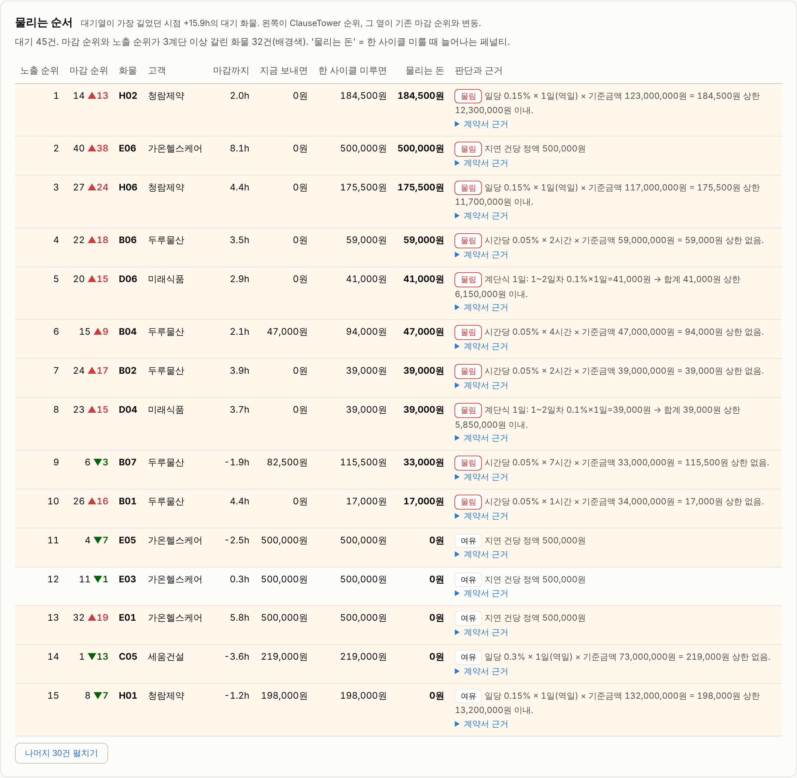

각 행의 "계약서 근거"를 펼치면 조항 번호와 원문 인용이 나오고, "계약 항목별 상세"가 그 고객의 계약 서랍을 판단 항목에서 연다.

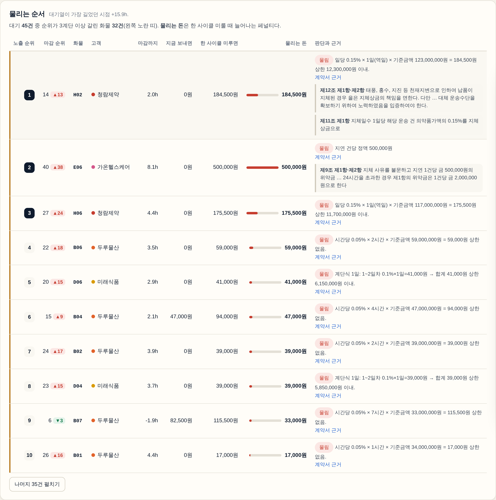

### 3-3. 누적 배상금와 정책 비교

기존 곡선은 +24시간 이후 가파르게 오르고 ClauseTower는 +36시간에서 멈춘다. 오른쪽은 같은 화물·같은 교란에서 순서만 다른 정책 6개의 총 배상금이다. 고액 화물 순은 17,610,500원으로 가장 나쁘다. **화물가액이 아니라 배상 노출액이 순서를 정한다.**

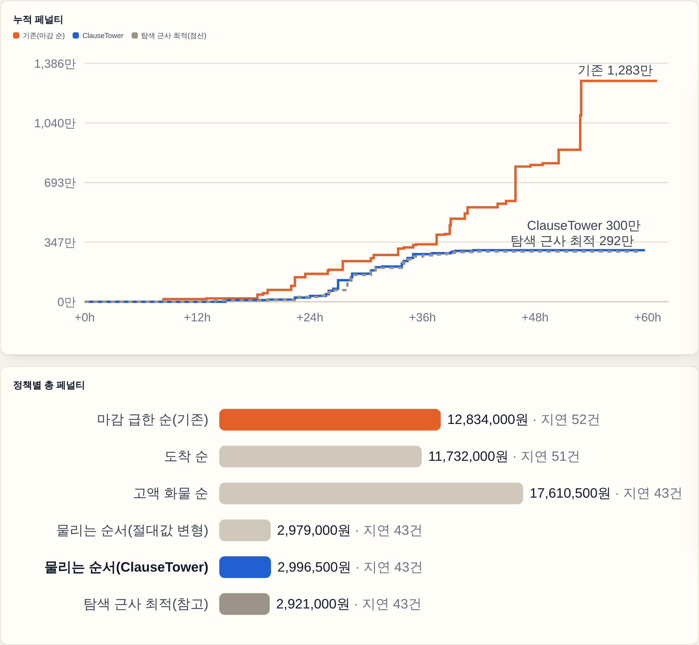

### 3-4. 계약 케이스: 카드와 비교표

고객 8곳의 계약 조건을 항목 격자로 보여 준다. 과금 방식, 유예, 상한(막대), 기준금액, 불가항력 사유 칩, 통지 시한, 정성 조건, 이번 사건의 판단과 이유, 정책별 배상금이 한 카드에 고정 위치로 있다. 한빛전자·바로유통·누리에너지는 면책 적용으로 0원. 두루물산은 면책 조항이 없고 상한도 없어 배상금이 가장 크지만, 순서를 바꿔 278만 원이 75만 원으로 줄었다.

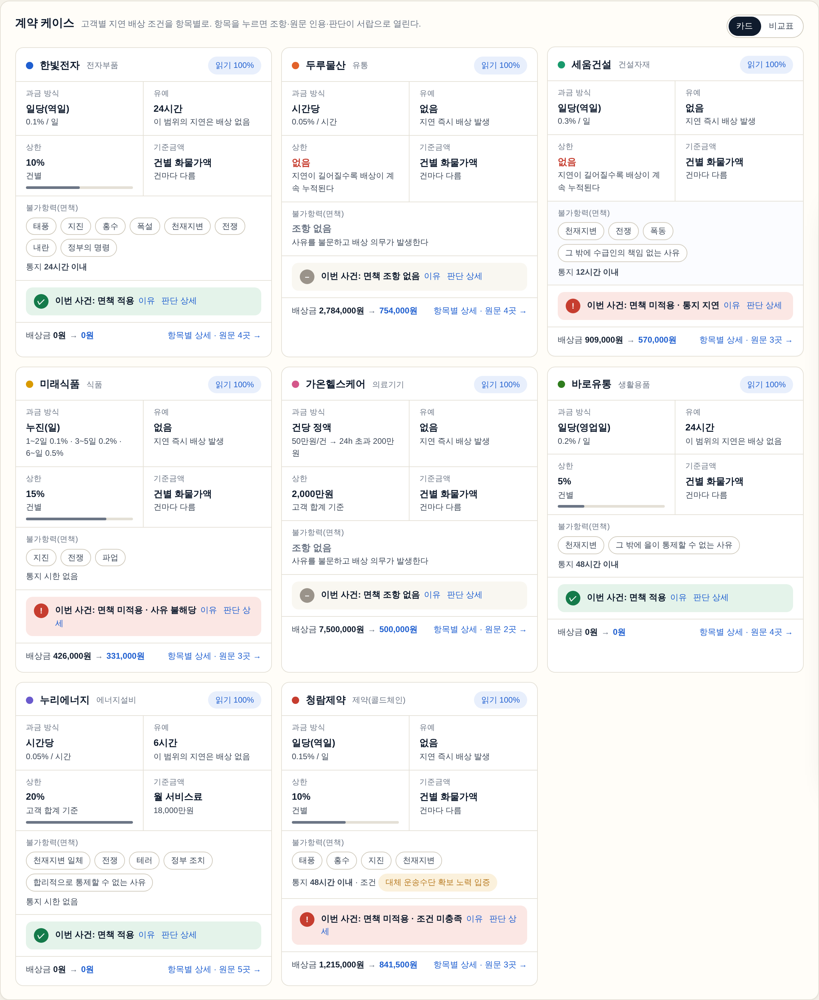

비교표는 같은 항목을 고객 × 항목 행렬로 본다. 화면 폭에 맞춰 가로 스크롤 없이 들어가고, 어느 칸을 눌러도 그 항목의 상세가 열린다.

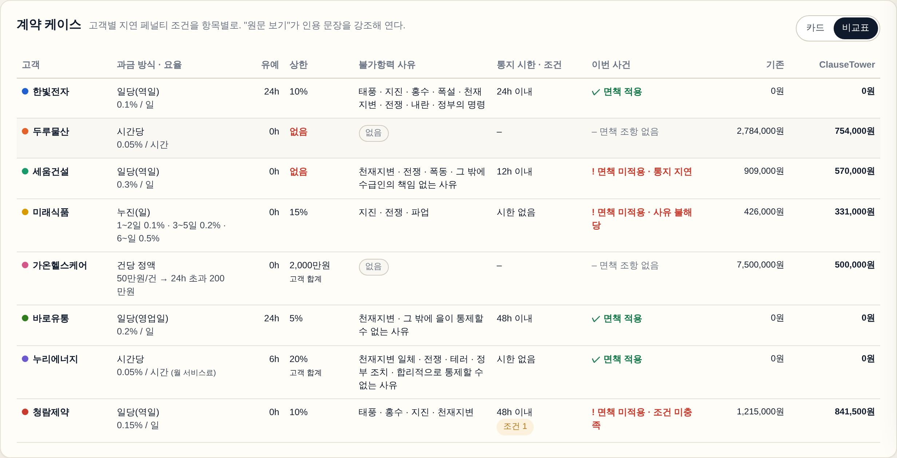

### 3-5. 계약 상세 서랍: 항목별과 전문

카드의 항목, 비교표의 칸, 조치 보드의 "조항 보기", 순위표의 "계약 항목별 상세"가 모두 같은 서랍을 그 항목 위치에서 연다.

**항목별 탭.** 과금 방식·요율, 기준금액, 유예, 상한, 단위 올림, 불가항력(사유·통지 시한·조건), 이번 사건 판단. 항목마다 값, 운영에 뜻하는 바("유예 범위 안의 화물은 보류해도 배상이 발생하지 않는다"), 조항 번호, 원문 인용이 붙는다. 이번 사건 판단은 조항 있음 → 사유 해당 → 통지 충족 → 조건 충족의 체크리스트라 어디서 면책이 끊겼는지 바로 보인다. 청람제약은 태풍이 면책 사유에 있고 48시간 통지도 지켰지만 "대체 운송수단 확보 노력 입증" 조건이 미충족이라 면책이 안 된다.

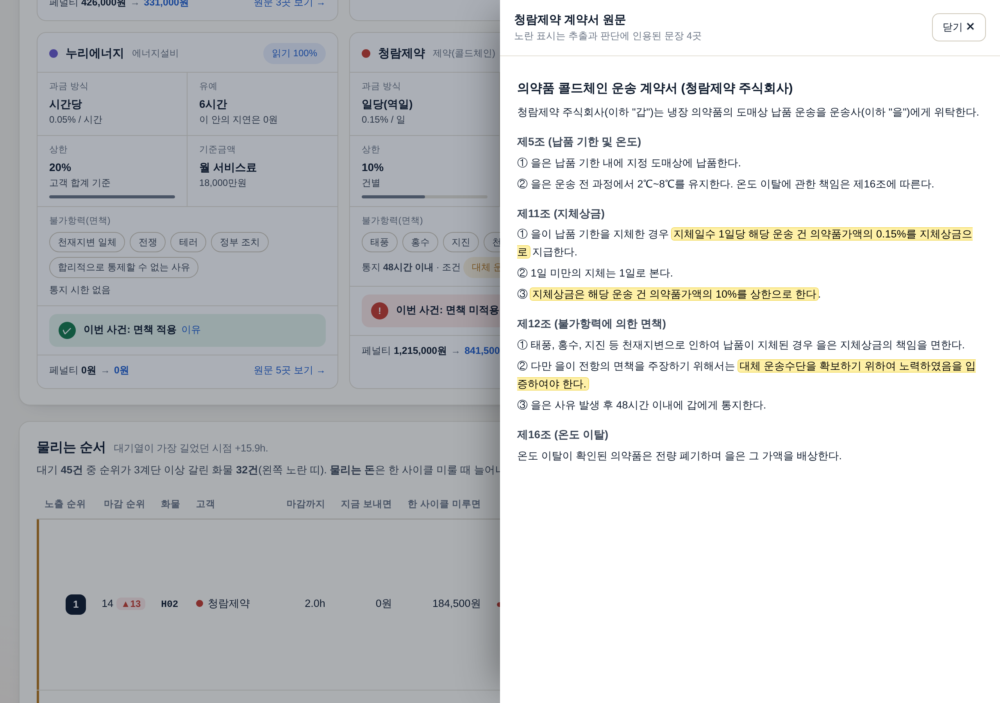

**전문 탭.** 계약서 전문에 추출과 판단에 인용된 문장을 노랗게 강조한다. 항목별 탭의 "원문에서 보기"를 누르면 해당 문장으로 건너뛰어 깜빡인다. 심사위원이 "그 조항 어디 있어요?"라고 물으면 두 번의 클릭으로 답한다.

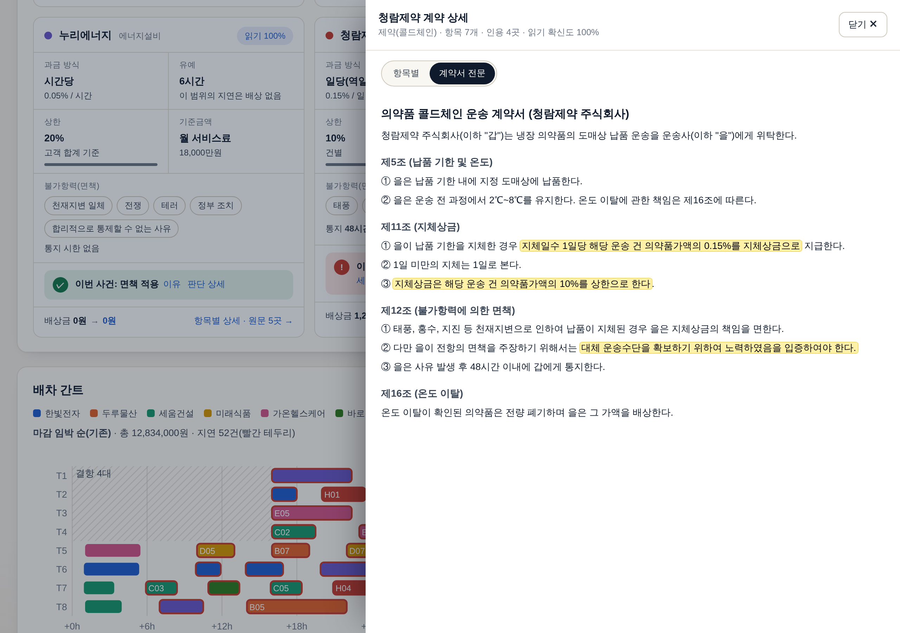

### 3-6. 배차 간트

같은 트럭, 같은 결항(빗금). 순서만 바뀌었는데 빨간 테두리(지연) 52건이 43건으로, 배상금은 4분의 1로 줄었다. 막대에 마우스를 올리면 출발·도착·마감·배상금·판단 근거가 뜬다.

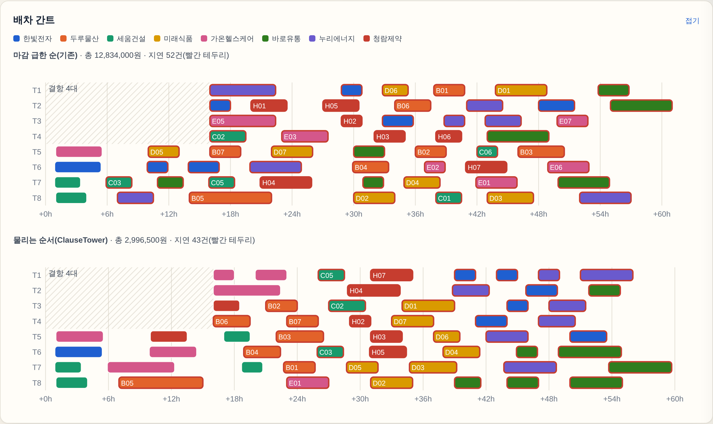

### 3-7. 웹 데모: 조건을 바꿔 가며 본다

https://namojo.github.io/clausetower/ 는 서버가 없는 정적 페이지다. 파이썬 계산기와 시뮬레이터를 JavaScript로 옮겼고(`src/clausetower/web/engine.js`), 같은 입력에서 파이썬과 같은 총 배상금이 나오는지 `scripts/verify_engine.js`가 31개 항목을 대조한다(전부 일치).

왼쪽 고정 패널에서 바꿀 수 있는 것:

| 묶음 | 항목 | 효과 |
| --- | --- | --- |
| 사건 | 사건 유형과 설명(직접 입력), 고객 통지 시점(슬라이더), 사실 관계 체크(입증 자료 등) | 통지 시한과 정성 조건이 걸린 면책 판단이 조건 결합으로 즉시 다시 계산된다 |
| 운영 | 트럭 수, 결항 대수, 결항 종료 시각, 피해 노선 이동시간 배율 | 시뮬레이션이 다시 돌고 모든 화면이 갱신된다 |
| 화물·출처 | 화물 배치 5종(가액·노선·마감만 다른 56건), 계약 읽기 출처(정답지 또는 실제 Claude 추출) | 정답지와 실제 모델 결과를 바꿔 가며 비교한다 |
| 면책 판단 | 고객별 "자동 / 적용 / 미적용 + 이유" | 사람이 뒤집은 판단은 카드에 "사람 결정"으로 표시된다 |

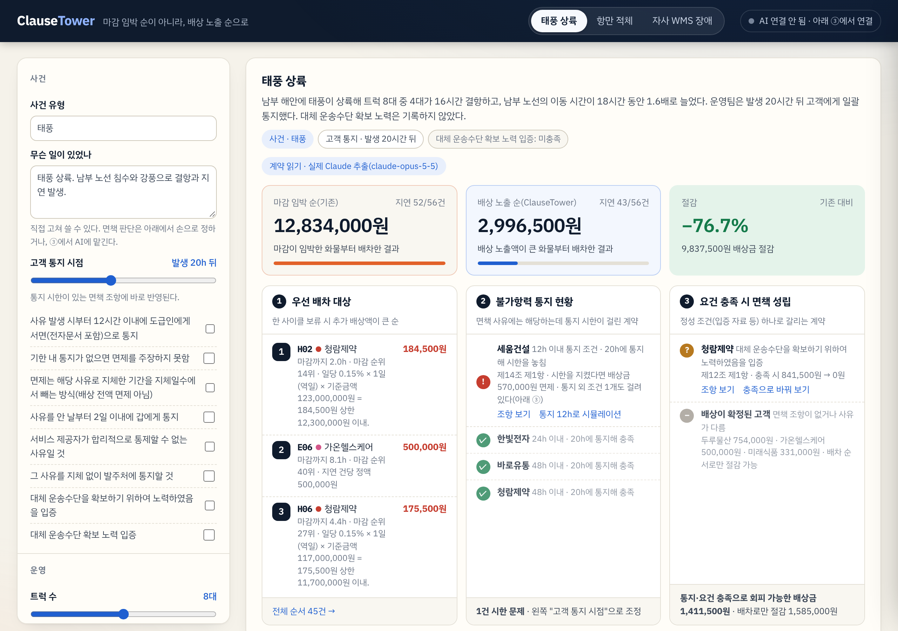

### 3-8. 실제 케이스 분석: 계약서를 올리면 AI가 바로 읽는다

화면 아래 "실제 케이스 분석"에서 계약서(txt, md, docx 또는 붙여넣기)를 올리면 LLM이 조건을 추출하고 현재 사건의 면책을 판단한 뒤 가상 화물 7건과 함께 시뮬레이션에 들어간다. 사건을 직접 적으면 8개 계약의 면책을 다시 판단한다. 인용이 원문과 글자 그대로 일치하는지 브라우저가 검사해 알려 준다.

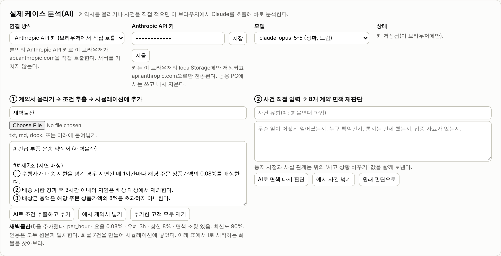

연결 방식은 세 가지다. 계약서 본문은 선택한 LLM 엔드포인트 외에는 어디에도 전송되지 않고, 키는 브라우저 localStorage에만 남는다.

| 연결 방식 | 준비 | 흐름 |
| --- | --- | --- |
| Anthropic API 키 | 키를 입력 | 브라우저 → api.anthropic.com 직접 호출(tool use로 구조화 출력) |
| 로컬 도우미(Claude 구독, Claude Code CLI) | PC에서 `python -m clausetower serve --llm claude-code` | 브라우저 → 127.0.0.1:8787 → 기존 `llm.py`가 CLI로 처리. 사내 LLM 중계도 같은 경로(`--llm openai`) |
| 사내·호환 엔드포인트 | 기본 주소, 모델 이름, 토큰 입력 | 브라우저 → OpenAI 호환(`/chat/completions` + tools) 또는 Anthropic 호환(`/v1/messages`) 직접 호출. CORS가 막히면 도우미로 중계 |

로컬 도우미를 Claude 구독으로 띄우고 예시 계약서를 올린 실제 실행이다. 추출에 22초가 걸렸고 요율·유예·상한·면책 사유·통지 시한을 모두 맞게 읽었으며 인용은 원문과 일치했다.

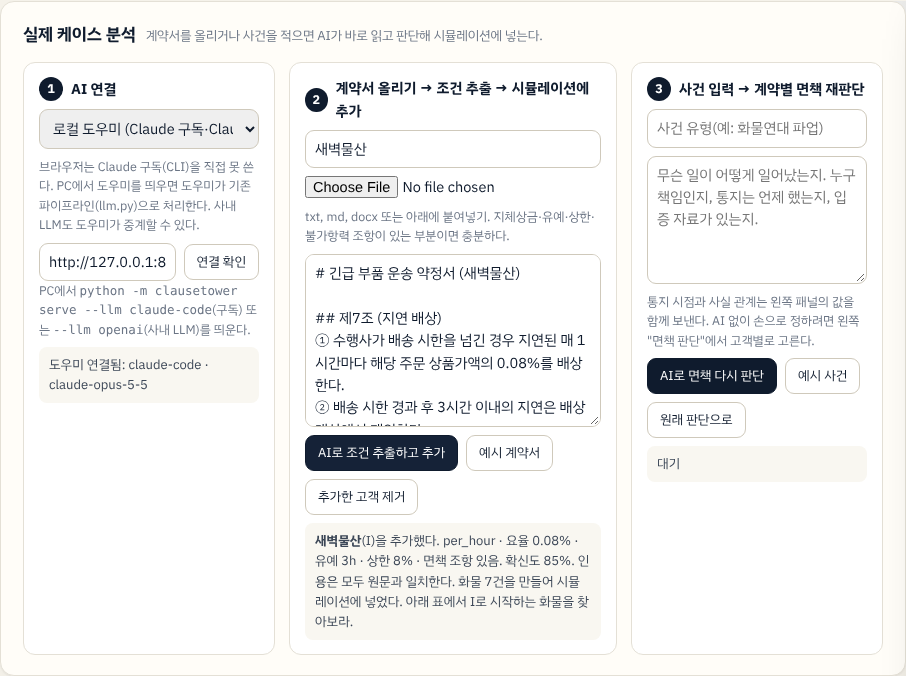

### 3-9. 다른 시나리오도 같은 화면으로

탭을 바꾸면 항만 적체와 자사 WMS 장애가 같은 화면으로 나온다. 미리 짠 결과가 아니라는 것을 보이기 위해 세 시나리오를 모두 준비했다.

**항만 적체.** 선사 사정으로 반출이 14시간 밀렸다. 천재지변이 아니라 면책 지형이 달라진다. "그 밖에 을이 통제할 수 없는 사유" 같은 포괄 조항이 있는 계약만 면책을 받는다.

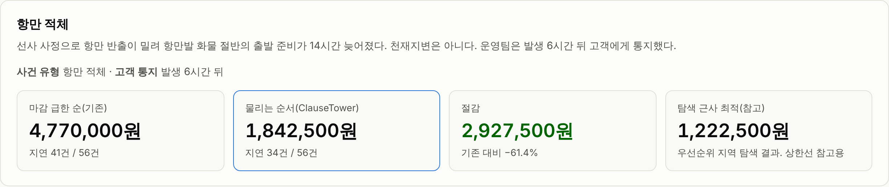

**자사 WMS 장애.** 운송사 귀책이라 아무도 면책을 못 받는다. 유예와 상한만 변수가 되고, 그래도 순서만 바꿔 58.3%를 줄인다.

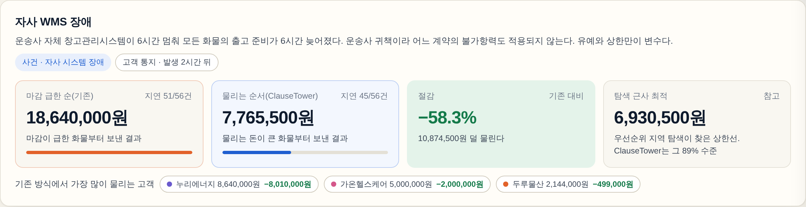

### 3-10. 실제 Claude가 읽은 결과

위 화면은 계약 조건에 정답지를 쓴 것이다(mock 모드). 실제 Claude(claude-opus-5-5)가 계약서 8부를 읽은 결과로 그린 화면은 다음과 같다. 카드 오른쪽 위의 "읽기 N%"가 모델이 보고한 확신도다. 통지 요건을 정성 조건으로도 한 번 더 적은 것 외에는 정답지와 같고, 태풍 시나리오의 총 배상금은 두 번의 실행 모두 정답지와 완전히 같다.

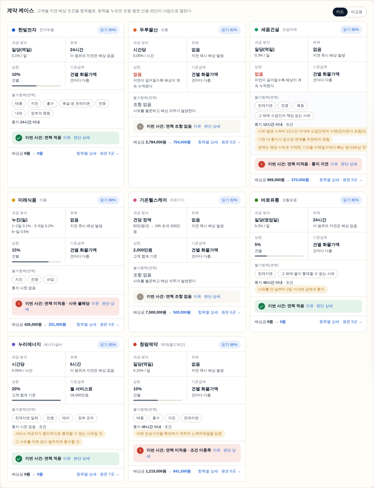

---

## 4. 데모 데이터: 계약 8부와 사건 3종

### 4-1. 가상 고객 8곳의 계약 조건

조항 구조를 일부러 다르게 설계해 "마감 임박 순"과 "배상 노출 순"이 갈리게 했다. 계약서 전문은 `contracts/*.md`, 팀이 작성한 정답지는 `contracts/golden/*.yaml`에 있다.

| 고객 | 업종 | 과금 방식 · 요율 | 유예 | 상한 | 불가항력 사유 | 통지 시한 · 조건 |
| --- | --- | --- | ---: | --- | --- | --- |
| 한빛전자 | 전자부품 | 일당(역일) 0.1% | 24h | 10% 건별 | 태풍·지진·홍수·폭설·천재지변·전쟁·내란·정부의 명령 | 24h 이내 |
| 두루물산 | 유통 | 시간당 0.05% | 없음 | **없음** | **조항 없음**(사유 불문) | – |
| 세움건설 | 건설자재 | 일당(역일) 0.3% | 없음 | **없음** | 천재지변·전쟁·폭동·그 밖에 수급인의 책임 없는 사유 | **12h 이내 서면** |
| 미래식품 | 식품 | 누진(일) 1~2일 0.1% · 3~5일 0.2% · 6일~ 0.5% | 없음 | 15% 건별 | 지진·전쟁·파업(태풍 없음) | 시한 없음 |
| 가온헬스케어 | 의료기기 | **건당 정액 50만 원**, 24h 초과 200만 원 | 없음 | 2,000만 원 고객 월 합계 | **조항 없음**(사유 불문) | – |
| 바로유통 | 생활용품 | 일당(영업일) 0.2% | 24h | 5% 건별 | 천재지변·그 밖에 을이 통제할 수 없는 사유 | 48h 이내 |
| 누리에너지 | 에너지설비 | 시간당 0.05% (월 서비스료 1.8억 기준) | 6h | 20% 고객 합계 | 천재지변 일체·전쟁·테러·정부 조치·합리적으로 통제할 수 없는 사유 | 시한 없음 |
| 청람제약 | 제약(콜드체인) | 일당(역일) 0.15% | 없음 | 10% 건별 | 태풍·홍수·지진·천재지변 | 48h 이내 · **대체 운송수단 확보 노력 입증** |

### 4-2. 교란 시나리오 3종

| 시나리오 | 무슨 일 | 운영 변수 | 통지 | 면책 지형 |
| --- | --- | --- | --- | --- |
| 태풍 상륙 | 남부 노선 침수와 강풍 | 트럭 8대 중 4대 16시간 결항, 남부 노선 S1~S3 이동시간 1.6배(18시간) | 발생 20시간 뒤 일괄 통지, 대체 운송 노력 기록 없음 | 한빛·바로·누리 면책. 세움은 12h 통지를 놓침. 청람은 입증 조건 미충족 |
| 항만 적체 | 선사의 선적 지연으로 반출 14시간 지연 | 항만 노선 P1·P2 화물 절반의 출고 준비 14시간 지연 | 발생 6시간 뒤 | 천재지변이 아니라 포괄 조항("통제할 수 없는 사유")이 있는 계약만 면책 |
| 자사 WMS 장애 | 운송사 WMS 장애로 출고 6시간 중단 | 전 화물 출고 준비 6시간 지연 | 발생 2시간 뒤 | 운송사 귀책이라 면책 없음. 유예와 상한만 변수 |

네트워크 모형은 허브 1곳, 노선 8개, 트럭 8대, 화물 56건(건당 1적재)이다. 화물 배치는 시드로 바뀌며 웹 데모에는 5종, 견고성 평가에는 30종을 썼다.

---

## 5. 어떻게 동작하나

### 5-1. 파이프라인

```
contracts/*.md ──(LLM extract)──▶ PenaltyTerms + 인용 ─┐
scenarios/*.yaml ─(LLM judge)──▶ ForceMajeureJudgment ─┼─▶ exposure.py(결정적 계산기) ─▶ Breakdown(금액 + 계산 단계 + 인용)
                                                         │
sim.py: 트럭이 빌 때마다 정책이 다음 화물을 고른다 ◀──────┘   정책 = 마감 순 | 도착 순 | 고액 순 | 배상 노출 순(시간당·절대값) | 탐색 근사 최적
        └─▶ PolicyResult(총 배상금, 지연 건수, 간트, 누적 곡선)
agent.py: 위를 묶어 Report(JSON) ─▶ dashboard.py(단일 HTML, 오프라인) / web(engine.js로 브라우저에서 재계산) / eval
```

### 5-2. 계약 읽기와 면책 판단(LLM)

- **구조화 출력.** `prompts/extract.md`와 pydantic 스키마 `PenaltyTerms`로 추출한다. 항목별 `citations`(조항 번호 + 원문 인용)와 `confidence`, `ambiguities`를 함께 받는다. 인용이 계약서에 글자 그대로 있는지 코드가 확인한다.
- **면책 판단.** `prompts/judge.md`로 사건 설명 × 계약 조항을 대조해 `has_clause`, `event_covered`, `notice_ok`, `conditions_met{조건: 충족}`을 받는다. 최종 `applies`는 모델 값을 버리고 네 조건의 논리곱으로 다시 만든다. 통지 시점이나 사실 관계가 바뀌면 LLM을 다시 부르지 않고 이 결합만 다시 계산한다.
- **보수적으로 틀리게.** 애매하면 배상금을 잡는 쪽으로 판단하도록 프롬프트했다. 실제 모델 측정에서 갈린 1건(항만 적체의 누리에너지)이 이 방향으로 틀렸다.

### 5-3. 노출액 계산기(결정적 코드)

`exposure.py`의 `compute_penalty`는 입력이 같으면 출력이 같고, 계산 단계를 문장으로 남긴다.

1. 면책이 적용되면 0원, 근거는 판단의 인용.
2. 지연에서 유예를 뺀다. 유예 안이면 0원.
3. 단위(시간·역일·영업일)로 나누고 1단위 미만은 올림(계약에 따라).
4. 요율 × 기준금액(건별 화물가액 또는 월 서비스료), 누진이면 구간별 합, 정액이면 건당 금액(가중 정액 포함).
5. 건별 상한을 적용하고, 고객·기간 합계 상한은 시뮬레이션 안에서 누적으로 적용한다.

"즉시 배차 시"과 "한 사이클 보류 시"을 각각 계산해 그 차이를 배상 노출액으로 쓴다.

### 5-4. 배차 정책과 시뮬레이터

트럭이 빌 때마다 대기 화물 중 하나를 고르는 규칙만 다르고 나머지는 전부 같다.

| 정책 | 고르는 기준 |
| --- | --- |
| 마감 임박 순(기존) | 마감이 가장 가까운 화물 |
| 도착 순 | 먼저 준비된 화물 |
| 고액 화물 순 | 화물가액이 큰 화물 |
| **배상 노출 순(ClauseTower)** | 한 사이클 보류했을 때 늘어나는 배상금을 그 화물이 트럭을 묶는 시간으로 나눈 값이 큰 화물 |
| 배상 노출 순(절대값) | 위 값을 시간으로 나누지 않은 변형 |
| 탐색 근사 최적(참고) | 우선순위 지역 탐색으로 찾은 상한선. 진짜 최적은 아니다 |

### 5-5. LLM 연결 방식

파이썬 파이프라인의 LLM 호출은 `llm.py` 한 곳을 지나며 모드는 네 가지다. 기본 `auto`는 API 키 → 사내 엔드포인트 설정 → Claude Code CLI → mock 순으로 고른다. 호출은 스레드 풀로 병렬이고(기본 4) 실패하면 정답지로 대체한 뒤 횟수를 보고서에 남긴다.

| 모드 | 무엇 | 언제 |
| --- | --- | --- |
| `mock` | 정답지를 그대로 사용, 네트워크 없음 | 테스트, 오프라인 데모 |
| `claude-code` | Claude Code CLI를 서브프로세스로 호출 | API 키 없이 Claude 구독으로 |
| `anthropic` | Anthropic SDK | `ANTHROPIC_API_KEY`가 있을 때 |
| `openai` | OpenAI 호환 chat/completions + 강제 tool call | 사내 LLM(`CLAUSETOWER_OPENAI_BASE_URL`, `CLAUSETOWER_OPENAI_API_KEY`, `CLAUSETOWER_MODEL`) |

웹 데모의 세 연결 방식(API 키 직접, 로컬 도우미, 사내·호환 엔드포인트)은 3-8절에 있다. 로컬 도우미(`server.py`)는 `/extract`와 `/judge` 두 엔드포인트로 위 `llm.py`를 그대로 쓰며 계약 본문을 기록하지 않는다.

---

## 6. 측정 결과

**정책 비교**(mock, 계약 조건은 정답지). 트럭 8대, 화물 56건, 시간 단위는 사건 발생 후.

| 시나리오 | 마감 임박 순(기존) | 도착 순 | 고액 화물 순 | **ClauseTower** | 탐색 근사 최적(참고) | 절감 |
| --- | ---: | ---: | ---: | ---: | ---: | ---: |
| 태풍 상륙 | 12,834,000 | 11,732,000 | 17,610,500 | **2,996,500** | 2,921,000 | 76.7% |
| 항만 적체 | 4,770,000 | 4,559,500 | 9,660,500 | **1,842,500** | 1,222,500 | 61.4% |
| 자사 WMS 장애 | 18,640,000 | 25,076,000 | 20,681,500 | **7,765,500** | 6,930,500 | 58.3% |

**태풍 시나리오의 고객별 배상금**(원). 면책을 받는 세 고객은 어느 정책이든 0원이고, 나머지는 순서만 바꿔 줄었다.

| 고객 | 기존(마감 순) | ClauseTower | 왜 |
| --- | ---: | ---: | --- |
| 가온헬스케어 | 7,500,000 | 500,000 | 건당 위약금이 정액이라 보류 즉시 배상이 발생한다. 배상 순위 2위로 올려 배차했다 |
| 두루물산 | 2,784,000 | 754,000 | 면책도 상한도 없는 시간당 요율. 매 시간 배상금이 누적된다 |
| 청람제약 | 1,215,000 | 841,500 | 입증 조건 미충족으로 면책 불가. 입증 자료만 있으면 0원 |
| 세움건설 | 909,000 | 570,000 | 12h 통지를 놓쳐 면책 불가. 시한을 지켰다면 0원 |
| 미래식품 | 426,000 | 331,000 | 태풍이 면책 사유에 없음. 누진 요율 |
| 한빛전자·바로유통·누리에너지 | 0 | 0 | 면책 적용 |

**다중 시드**(시드 30개로 화물 가액·노선·마감을 바꿔 반복, `eval/results/robustness.md`): 태풍 30/30 승, 절감 평균 69.1%(49.6~82.1). 항만 30/30, 58.7%(32.4~83.5). WMS 30/30, 62.4%(41.7~72.2).

**실제 모델**(`claude-code`, claude-opus-5-5). 같은 계약서 8부와 시나리오 2종을 두 번 돌렸다. 2회차는 추출 프롬프트의 한 구절("지연 페널티 조건" → "지연 배상 조건")을 고친 뒤의 실행이다. 현재 보고서는 `eval/results/real/`, 1회차는 `eval/results/real_prev/`, 채점은 `eval/results/extraction_*.json`.

| 항목 | 1회차 | 2회차(현재) |
| --- | --- | --- |
| 계약 조건 추출 정확도(8부, 106항목) | 96.2% (102/106) | 95.3% (101/106) |
| 틀린 항목의 성격 | 전부 면책의 정성 조건 개수. 통지 요건을 조건으로도 한 번 더 적음 | 같음. 누리에너지는 열거 사유 5개 중 4개로 읽음("등"으로 묶인 표현). 금액 계산에 영향 없음 |
| 면책 판단 정확도(32항목) | 태풍 100%, 항만 적체 96.9% | 태풍 100%, 항만 적체 93.8% |
| 판단이 갈린 건 | 항만 적체의 누리에너지 1건을 보수적으로 면책 보류 | 누리에너지에 더해 세움건설 1건. "서면" 통지 여부가 사건 설명에 없어 조건 미충족으로 보류. 둘 다 배상금을 잡는 쪽으로 틀림 |
| 인용 원문 일치율 | 100% | 100% |
| 태풍 시나리오 정책 비교 | 정답지와 동일(12,834,000 → 2,996,500) | 동일 |
| 호출·비용·시간 | 24회, $1.98, 270초 | 24회, $2.06, 283초(4개 병렬), mock 대체 0회 |
| 웹 데모 구독 경로 | 예시 계약서 추출 22초, 조건 전부 정확, 인용 원문 일치 | – |

두 번 모두 같은 종류로 틀렸다. 모델은 통지 요건을 정성 조건으로 한 번 더 적고, 애매한 면책은 보류한다. 둘 다 프롬프트가 요구한 보수적 방향이며, 화면에는 "조건 미충족"과 그 이유가 그대로 드러나 사람이 확인한다.

---

## 7. 선행 조사: 이미 있는 것과 없는 것

주제를 고르기 전에 검색 9회(영어·한국어)로 겹치는 제품과 논문을 찾았다. "세상에 없다"는 증명은 불가능하고, 아래는 찾지 못했다는 기록이다.

- **있다.** SLA 마감 긴급도를 가중치로 쓰는 [현장서비스 배차](https://fieldcode.com/en/field-service-daily/how-ai-supports-sla-aware-scheduling), SLA 배상금을 비용 함수에 넣는 [클라우드 스케줄링 연구](https://arxiv.org/pdf/2505.12355), 계약서에서 배상금 조항을 분류·추출하는 [특허](https://image-ppubs.uspto.gov/dirsearch-public/print/downloadPdf/11755973), SLA 위반을 예측해 재배차를 트리거한다는 [물류 벤더 자료](https://oxmaint.com/industries/delivery-operations-management/ai-improve-sla-performance-delivery-operations).
- **못 찾았다.** 계약서 **조항의 구조**(요율 단위, 유예, 상한, 불가항력의 열거·포괄 표현, 통지 시한, 입증 조건)를 읽어 사건별 **실제 노출액**으로 바꾸고, 그 값으로 운영 배차를 바꾸며, 모든 판단에 원문을 인용하는 것. 한국어 지체상금 맥락에서는 관련 자료 자체가 없었다.
- 차별점을 한 문장으로: **"마감 긴급도"가 아니라 "계약이 실제로 배상 노출액"으로 배차하고, 그 돈의 근거를 조항 원문으로 보여 준다.**

---

## 8. 빠른 시작과 검증 절차

```bash
cd clausetower
python -m venv .venv && . .venv/bin/activate      # Windows: .venv\Scripts\activate
pip install -e ".[dev]"
python -m clausetower demo --llm mock             # 3개 시나리오 실행 + out/demo/dashboard.html (네트워크 불필요)
python -m clausetower run typhoon --llm mock      # 하나만
python -m clausetower serve --llm claude-code     # 웹 데모용 로컬 도우미(Claude 구독). --llm openai 로 사내 LLM
python scripts/build_site.py                      # 웹 데모를 site/에 조립
```

실제 Claude로 돌리려면 `--llm claude-code`(구독), `--llm anthropic`(API 키), `--llm openai`(사내 LLM) 중 하나를 고른다(5-5절). 계약 추출은 시나리오 간에 공유되어 호출은 8 + 시나리오당 8회다.

**검증 절차(심사용).** 모든 숫자는 아래 명령으로 다시 나온다.

```bash
pytest -q                                              # 39 passed
python -m clausetower demo --llm mock                  # 6절 표의 숫자가 그대로 나온다(결정적)
python eval/run_eval.py robustness --seeds 30          # 90/90 승, 평균 절감률
python eval/run_eval.py extraction eval/results/real/report_typhoon.json   # 실제 모델 결과 채점(저장된 보고서)
python scripts/build_site.py && node scripts/verify_engine.js              # 웹 엔진 31/31 일치
node scripts/smoke_web.js site/index.html /tmp/shots                       # 브라우저 스모크(Playwright, API는 가짜 응답)
```

mock 모드에서 추출 정확도 100%는 정답지를 그대로 쓰기 때문이며 의미가 없다. 실제 모델 수치는 저장된 보고서(`eval/results/real/`)와 실행 로그(`run.log`)로 확인한다.

---

## 9. 저장소 구조와 설계 원칙

```
clausetower/
├── src/clausetower/
│   ├── schemas.py     데이터 계약(PenaltyTerms, Judgment, Breakdown, Report …)
│   ├── exposure.py    배상금 계산기. 결정적·순수. 유예→단위→요율/누진/정액→상한, 고객 합계 상한
│   ├── llm.py         LLM 단일 출입구(mock | claude-code | anthropic | openai | auto), 구조화 출력, 병렬, 실패 시 대체·기록
│   ├── extract.py     계약 → PenaltyTerms(인용 포함), 사건 × 계약 → 불가항력 판단(조건 기계적 결합)
│   ├── sim.py         배송 네트워크 시뮬레이터, 정책 5개, 우선순위 지역 탐색
│   ├── agent.py       파이프라인과 '배상 노출 순위' 표, 재시뮬레이션
│   ├── dashboard.py   단일 HTML 대시보드(인라인 SVG, 오프라인)
│   ├── server.py      웹 데모용 로컬 도우미(/extract, /judge, CORS)
│   ├── web/           engine.js(계산기·시뮬레이터 이식), render.js(공용 렌더: 조치 보드·보드·서랍·차트), app.js(조작 패널·라이브 AI), style.css
│   └── cli.py         run | demo | serve | eval
├── contracts/         가상 계약서 8부(.md)와 정답지(golden/*.yaml)
├── scenarios/         교란 3종(태풍, 항만 적체, 자사 WMS 장애)
├── prompts/           extract.md, judge.md
├── eval/              run_eval.py(robustness, extraction), results/(측정값, 실제 모델 보고서)
├── tests/             39개
├── scripts/           build_site.py(웹 데모 조립), verify_engine.js(JS≡Python 검증), smoke_web.js(브라우저 스모크), real_run.py, screenshot.js
├── .github/workflows/ pages.yml(테스트 → 조립 → 검증 → gh-pages 배포)
└── docs/              proposal.md(기획서), ax-hackathon-form.md(양식 답안), demo-script.md(3분 대본), screenshots/
```

**설계 원칙**

- 돈 계산에 LLM을 쓰지 않는다. `exposure.py`는 입력이 같으면 출력이 같고, 계산 단계를 문장으로 남긴다.
- 모든 조건에 조항 번호와 원문 인용이 붙는다. 인용이 계약서에 그대로 있는지 시험과 eval이 확인한다.
- 면책의 최종 적용 여부는 모델의 `applies`를 믿지 않고 `has_clause ∧ event_covered ∧ notice_ok ∧ 조건 충족`으로 다시 만든다.
- 어느 순서가 낫다는 주장은 시뮬레이션 숫자로만 한다. 정책은 "트럭이 빌 때 무엇을 먼저 보내는가"만 다르고 나머지는 같다.
- LLM 호출이 실패하면 정답지로 대체하고 횟수를 보고서에 남긴다. 데모는 mock으로도 끝까지 돈다.
- 웹 데모의 엔진은 파이썬의 이식이며 둘의 결과가 같다는 것을 자동으로 검증한다. 라이브 분석의 세 연결 방식은 가짜 응답으로 브라우저 스모크 테스트를 돌리고, 구독 경로는 실제 CLI로 확인했다.
- 화면은 조치가 먼저다. 상태는 색이 아니라 글자와 아이콘으로, 사람이 뒤집은 판단은 "사람 결정"으로 표시한다.

---

## 10. 한계와 다음

**한계(정직하게)**

- 시뮬레이터는 작은 모형이다(허브 1, 노선 8, 트럭 8, 화물 56, 건당 1적재). 절감률은 이 모형 안의 값이고 실제 네트워크 수치가 아니다.
- 계약서와 정답지를 같은 팀이 만들었다. 실제 계약서 블라인드 평가가 필요하다. 한국어 계약서만 다뤘다.
- 실제 모델 측정은 2개 시나리오 2회 실행이다. 두 번의 차이(추출 1항목, 판단 1건)가 모델 분산의 크기를 짐작하게 하지만 통계로 말하기에는 적다.
- 탐색 근사 최적은 지역 탐색이며 진짜 최적이 아니다.
- 교란 동시 발생, 부분 적재, 환적은 없다.
- 웹 데모는 정적 페이지라 LLM 호출에 사용자의 키나 로컬 도우미가 필요하다. 업로드 계약의 화물 7건은 가상으로 만든다. PDF와 HWP 업로드는 아직 없다(텍스트로 붙여넣기).
- 계약 해석의 최종 책임은 사람에게 있다. 이 도구는 노출액과 근거를 보여 주는 참모다.

**다음(목표)**

- PDF(스캔본 OCR 포함)·HWP 업로드와 긴 계약서에서 지체상금·면책 조항만 찾아내는 사전 분할.
- 통지 시한 카운트다운과 조항 인용이 들어간 통지 문안 초안 생성.
- 기존 TMS·배차 엔진에 "배상 노출액(원/시간)" 열 하나를 우선순위 입력으로 넘기는 API와 사람의 승인 흐름.
- 정답지·다중 시드 평가를 CI에 올려 프롬프트나 모델을 바꿀 때 정확도 하락을 막는 평가 루프.

---

## 11. 심사 기준에 대한 답과 문서

| 기준 | 어디서 확인하나 |
| --- | --- |
| AI 활용 수준 | LLM은 **읽기와 판단**(계약 조항 구조화, 불가항력 적용 여부)만 맡고 돈 계산은 코드가 한다. 구조화 출력(pydantic), 조건의 기계적 결합, 인용 검증, 실패 시 정답지 대체와 기록. `src/clausetower/extract.py`, `prompts/` |
| 문제 해결 방식 | "긴급도"이 아니라 "배상 노출액"으로 우선순위를 바꾸는 한 가지 변경. 같은 시뮬레이터에서 정책 5개를 나란히 비교하고 지역 탐색 상한선까지 둔다. `src/clausetower/sim.py` |
| 실제 업무 적용 가능성 | 기존 배차 엔진을 바꾸지 않고 우선순위 입력에 열 하나를 더하는 형태. 사건 직후 조치 보드. 모든 판단에 원문 인용. 사람이 최종 결정. 사내 LLM·구독·API 키 모두 지원 |
| 재현성 | 결정적 시뮬레이터, mock 모드, 시험 39개, 실제 모델 실행 보고서와 로그 2회분, JS≡Python 검증, 브라우저 스모크. 8절 "검증 절차" |

**문서**

- [기획서 전문](docs/proposal.md) — 문제, 통찰, 데모 장면 7개, 견고성, 실제 모델 결과, 화면 설계 원칙, 아키텍처, 사업 연결, 위험과 대응
- [AX해커톤 아이디어 기획서 양식 답안](docs/ax-hackathon-form.md) — 7개 문항
- [3분 데모 대본](docs/demo-script.md)
- 화면: `docs/screenshots/`(mock), `docs/screenshots/real/`(실제 모델), `docs/screenshots/web/`(웹 데모)

**배포.** `main`에 푸시하면 GitHub Actions가 테스트, 사이트 조립, 엔진 검증을 거쳐 `gh-pages` 브랜치로 배포한다(`.github/workflows/pages.yml`).
